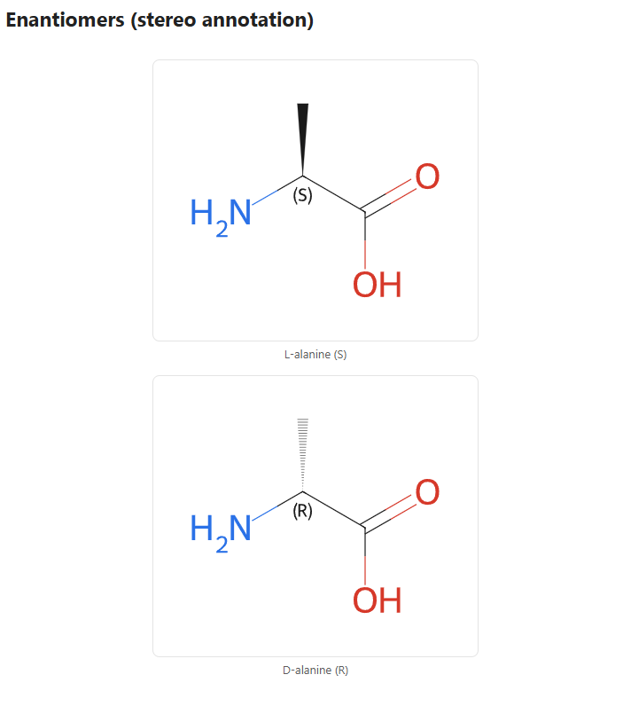

# Molren

[](https://obsidian.md/plugins?id=molren)
[](https://github.com/quiachonj/molren/releases)
[](LICENSE)

Molren renders 2D chemical structures from SMILES in your Obsidian notes. Write a SMILES string (or a molfile, SDF, or reaction) in a fenced code block and Molren draws the structure inline. It uses [RDKit.js](https://www.rdkit.org/), which runs locally, so nothing is uploaded.

Website: [molren.amberlogica.com](https://molren.amberlogica.com). Support: [Buy me a coffee](https://buymeacoffee.com/joshquiachon).

The structures stay as plain text, so they stay searchable and work with version control. The image is generated on the fly, offline.

<picture>
  <source media="(prefers-color-scheme: dark)" srcset="docs/screenshot-dark.png" />
  <source media="(prefers-color-scheme: light)" srcset="docs/screenshot-light.png" />
  
</picture>

## Install

In Obsidian: **Settings → Community plugins → Browse**, search **Molren**, then **Install** and **Enable**.

<details>
<summary><b>Other ways to install</b></summary>

- **BRAT**: to test the latest pre-release, add `quiachonj/molren` in the [BRAT](https://github.com/TfTHacker/obsidian42-brat) plugin.
- **Manual**: download `main.js`, `manifest.json`, and `styles.css` from a [release](https://github.com/quiachonj/molren/releases) into `<your-vault>/.obsidian/plugins/molren/`, then reload Obsidian.
- **From source**: see [Development](#development).

</details>

> [!IMPORTANT]
> Molren is desktop-only and requires Obsidian 1.4.0 or later.

## Usage

Molren reads fenced code blocks and draws what's inside. The language tag on the fence tells Molren what kind of input to expect.

1. In any note, add a code block tagged `smiles` with one structure:

   ````markdown
   ```smiles
   CCO
   ```
   ````

2. Switch to Reading or Live Preview. Molren draws ethanol inline.
3. Edit the SMILES and the image updates.

### Several molecules (a grid)

Put one SMILES per line to get a responsive grid, and add a caption after the first space:

````markdown
```smiles
CCO Ethanol
CC(=O)O Acetic acid
c1ccccc1 Benzene
```
````

Lines starting with `#` are treated as comments, so you can annotate a block:

````markdown
```smiles
# Common solvents
CCO Ethanol
CC(C)=O Acetone
```
````

### Stereochemistry

Stereo bonds and R/S and E/Z labels are drawn automatically. You can turn the labels off in Settings.

````markdown
```smiles
C[C@H](N)C(=O)O L-alanine
```
````

### Molfiles and SDF

Use a `mol` block for a single molfile. Molren keeps its authored coordinates. Use an `sdf` block for a multi-record SDF, where each record becomes a card and its title line becomes the caption.

````markdown
```mol
  (paste the full molblock here, ending in "M  END")
```

```sdf
  (paste SDF records separated by $$$$)
```
````

### Reactions

Use a `rxn` block for reaction SMILES (`reactants>>products`, or `reactants>agents>products`). Reactions render as wide, full-width rows.

````markdown
```rxn
CC(=O)O>[H+]>CC(=O)OCC Fischer esterification
```
````

### Not sure which fence? Use `chem`

A `chem` block auto-detects whether its contents are SMILES, a molfile, SDF, or a reaction. It's useful when pasting mixed content.

### Fences at a glance

| Fence    | Input                                 | Output                         |
| -------- | ------------------------------------- | ------------------------------ |
| `smiles` | one or more SMILES (one per line)     | a single card or a grid        |
| `mol`    | a single molfile / molblock           | one card, coordinates kept     |
| `sdf`    | an SDF file (records split by `$$$$`) | a grid, one card per record    |
| `rxn`    | reaction SMILES (with `>>`)           | full-width reaction rows       |
| `chem`   | any of the above, auto-detected       | the right result for the input |

> [!NOTE]
> In `smiles` and `rxn` blocks, text after the first space becomes a caption, `#` lines are comments, and a trailing CXSMILES `|...|` extension is kept as part of the structure. If a line can't be read, that block shows a small inline error (for example `⚠ Molren: invalid structure: C1CC`). One bad line won't stop the others.

New to SMILES? Copy the "Canonical SMILES" from a compound's PubChem or Wikipedia page, or draw a structure in a free editor like Ketcher and export SMILES.

## Settings

**Settings → Community plugins → Molren:**

| Setting            | What it does                                                  | Default |
| ------------------ | ------------------------------------------------------------- | ------- |
| Image width        | Width each structure is drawn at (also the grid column width) | 350     |
| Image height       | Height each structure is drawn at                             | 300     |
| Stereo annotations | Show or hide R/S and E/Z labels                               | On      |

## Features

- Multiple input formats: SMILES, molfile/molblock, SDF, and reactions, plus an auto-detecting `chem` fence.
- Grids with captions: one structure per line, laid out responsively.
- Stereochemistry: R/S and E/Z annotations, toggleable.
- Theme-aware: structures recolor for light and dark themes live, with no re-render.
- CoordGen layouts with tuned draw options.
- Local and offline: RDKit runs in WebAssembly, so nothing leaves your vault.
- Inline errors instead of blank boxes, plus cached rendering.

---

## Architecture

```
fence (smiles│mol│sdf│rxn│chem)
      │
      ▼
 parse.ts  →  detect format, split into structure specs (+ captions)
      │
      ▼
  svg.ts   →  RDKit → SVG (molecules + reactions), theme recolor
      │
      ▼
renderer.ts →  layout (single│grid│reaction stack), cache, mount
```

| File              | Responsibility                                                         |
| ----------------- | ---------------------------------------------------------------------- |
| `src/main.ts`     | Plugin entry. Registers the `smiles`/`mol`/`sdf`/`rxn`/`chem` fences.  |
| `src/parse.ts`    | Format detection and parsing block text into structure specs.          |
| `src/svg.ts`      | RDKit to SVG conversion (molecules and reactions) and theming.         |
| `src/renderer.ts` | Obsidian/DOM bridge: layout, caching, and mounting.                    |
| `src/rdkit.ts`    | Lazy, one-time RDKit wasm init from the inlined (gzipped base64) wasm. |
| `src/settings.ts` | Settings tab (dimensions, stereo annotations).                         |

## Development

```bash
npm install      # installs deps and pulls in the RDKit wasm
npm run dev      # esbuild watch → main.js (wasm inlined)
npm test         # vitest
npm run lint     # eslint (incl. Obsidian plugin rules)
npm run format   # prettier --write
npm run build    # type-check + production bundle
npm run check    # format:check + lint + test + build (what CI runs)
```

To develop against a real vault, symlink `molren/` into a test vault's
`.obsidian/plugins/`, then reload Obsidian (Ctrl+R) after each build.

## Implementation notes

> [!IMPORTANT]
> Molren is desktop-only (`isDesktopOnly: true`) and targets `minAppVersion` 1.4.0, so it uses the classic settings-tab API rather than the declarative one from 1.13.

1. **wasm delivery.** The RDKit `.wasm` (~6.9 MB raw) is gzipped at level 9 by the `gzip-rdkit-wasm` esbuild plugin and inlined into `main.js` as base64 text, which keeps `main.js` at about 3 MB. At load it is decoded with `atob`, gunzipped with `DecompressionStream`, and passed to `initRDKitModule({ wasmBinary })`. Inlining is required because community-store and BRAT installs only download `main.js`/`manifest.json`/`styles.css`. Extra release assets aren't fetched, so the wasm can't ship as a separate file.
2. **Coordinates.** SMILES carry none, so Molren generates a CoordGen 2D layout. Molfiles and SDF with 2D coordinates keep them; 3D coordinates get a fresh 2D layout, since drawing them as-is just projects x/y and can overlap atoms. The choice is made per structure via RDKit's `has_coords()` (0 none, 2 2D, 3 3D), not by fence.
3. **Theming.** RDKit bakes fixed colors into the SVG. Molren rewrites any dark near-grayscale "ink" (bonds, carbons, dummy atoms drawn as `#191919`, annotations) plus O/N as CSS variables, so one cached SVG adapts to light and dark live.
4. **SVG insertion.** Parsed via `DOMParser` + `importNode` (not `innerHTML`) per Obsidian's guidelines.
5. **RDKit types.** The shipped `@rdkit/rdkit` types omit the reaction API and the CJS default export, so both are declared locally in `src/rdkit.ts`.

## Roadmap

- [x] CoordGen depictions with tuned draw options
- [x] Multiple structures per block (grid)
- [x] molfile / SDF input
- [x] Reaction rendering
- [x] Theme-aware (dark mode) coloring
- [ ] Interactive structure editor (evaluating Ketcher vs Kekule.js)
- [ ] Optional 3D view (Mol\* / 3Dmol.js) for macromolecules

## Support

- [Buy me a coffee](https://buymeacoffee.com/joshquiachon)
- [molren.amberlogica.com](https://molren.amberlogica.com)

## License

[MIT](LICENSE). RDKit.js is distributed under the BSD-3-Clause license.
